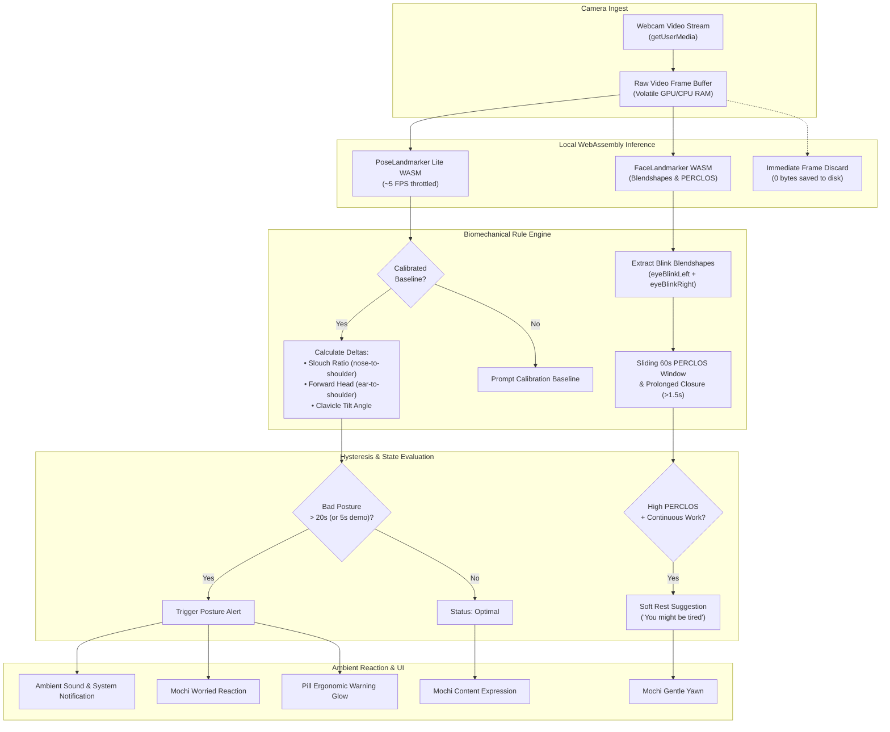
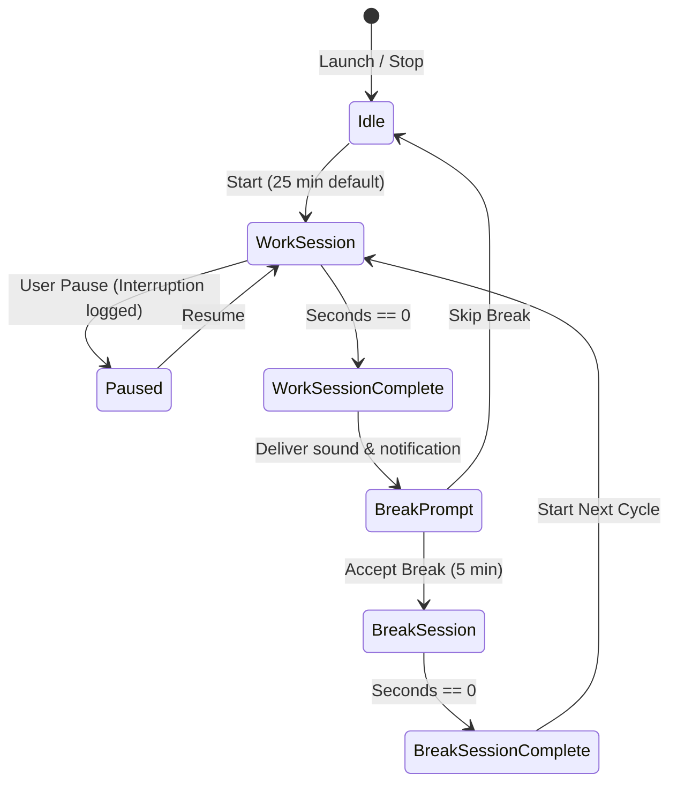
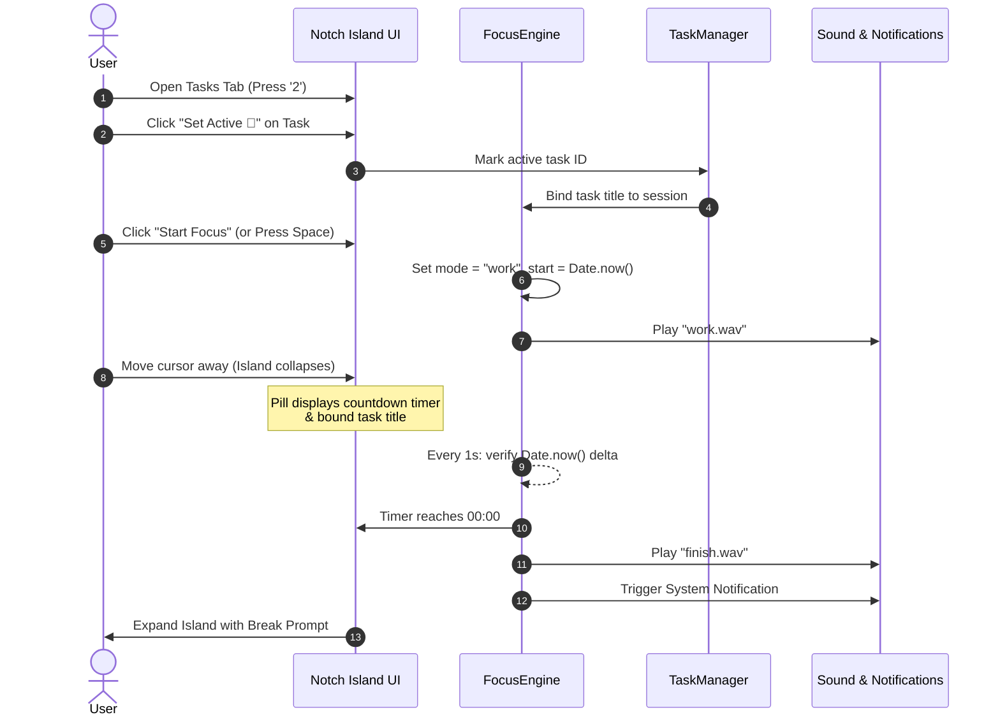
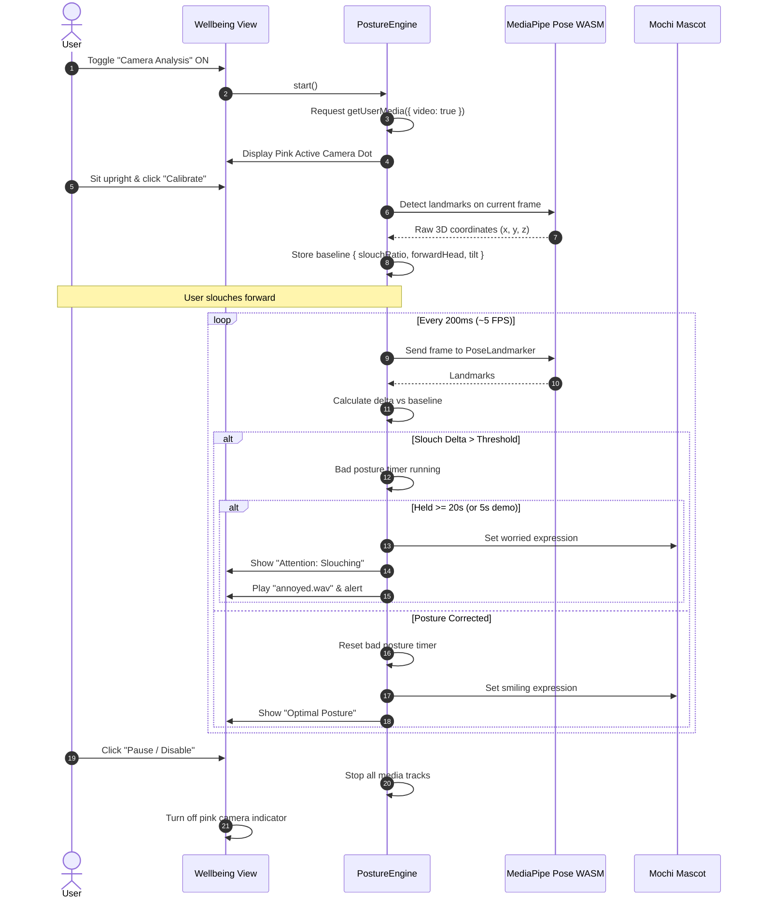

# Notch Companion (Ergonotch) 🌿

> **An ambient Windows desktop companion for deep focus, physical ergonomics, and daily wellbeing.**  
> Lives quietly at the top of your screen as a translucent dark island. **100% offline, zero telemetry, local-first privacy.**

[](https://jancherian.github.io/ergonotch/)
[](https://jancherian.github.io/ergonotch/about.html)
[](https://github.com/jancherian/ergonotch/releases/download/v1.0.4/Notch-Setup.exe)
[](https://github.com/jancherian/ergonotch/blob/main/LICENSE)
[](https://github.com/jancherian/ergonotch)

---

## 📑 Table of Contents

1. [Executive Overview & Problem Statement](#-executive-overview--problem-statement)
2. [Live Links & Quick Access](#-live-links--quick-access)
3. [System Architecture & Data Flow](#-system-architecture--data-flow)
   - [High-Level Architecture Diagram](#high-level-architecture-diagram)
   - [Computer Vision Pipeline Diagram](#computer-vision-pipeline-diagram)
   - [Window Lifecycle & Interaction States](#window-lifecycle--interaction-states)
4. [Comprehensive Technology Stack](#-comprehensive-technology-stack)
5. [Core Features & Functional Modules](#-core-features--functional-modules)
   - [Module 1: Deep Focus Engine & Task Manager](#1-deep-focus-engine--task-manager)
   - [Module 2: 100% Offline Posture & Biomechanical AI](#2-100-offline-posture--biomechanical-ai)
   - [Module 3: Facial Fatigue & PERCLOS Monitoring](#3-facial-fatigue--perclos-monitoring)
   - [Module 4: Honest Habits & Guided Micro-Resets](#4-honest-habits--guided-micro-resets)
   - [Module 5: Evidence-Based Insights & Data Provenance](#5-evidence-based-insights--data-provenance)
   - [Module 6: Ambient Mochi Companion & Audio Feedback](#6-ambient-mochi-companion--audio-feedback)
6. [System Workflows & Lifecycles](#-system-workflows--lifecycles)
   - [Focus Session Lifecycle](#focus-session-lifecycle)
   - [Camera Posture Feedback Loop](#camera-posture-feedback-loop)
   - [Break & Interruption Management](#break--interruption-management)
7. [Repository & Project Structure](#-repository--project-structure)
8. [Keyboard Shortcuts Reference](#-keyboard-shortcuts-reference)
9. [Local Development & Build Guide](#-local-development--build-guide)
10. [Privacy, Security & Zero-Telemetry Guarantee](#-privacy-security--zero-telemetry-guarantee)
11. [Troubleshooting & FAQs](#-troubleshooting--faqs)
12. [Deliberate Non-Goals & Future Roadmap](#-deliberate-non-goals--future-roadmap)
13. [Credits & Open-Source Licensing](#-credits--open-source-licensing)

---

## 🌿 Executive Overview & Problem Statement

### The Problem
Modern knowledge workers, engineers, and digital creators spend 8–12 hours a day seated in front of displays, falling prey to three silent challenges:
1. **Ergonomic Blind Spots:** Prolonged immersion pulls the body unconsciously into **forward-head posture ("tech neck")**, rounded shoulders, and collapsed thoracic alignment. At the same time, screen gaze causes a dramatic drop in natural blink rate, producing chronic eye strain, headaches, and physical fatigue.
2. **Disruptive Productivity Utilities:** Traditional timer and task apps demand full-screen focus, interrupt flow states with abrasive modal dialogs, or rely on invasive surveillance like keyloggers and screen capture.
3. **The Cloud AI Privacy Trap:** Modern "smart" webcam tools stream video frames, audio, and biometrics to external cloud infrastructure, introducing severe enterprise and personal privacy risks.

### The Solution: Notch Companion
**Notch Companion** bridges cognitive deep work and physical health by operating as an **ambient, non-distracting floating island at the top edge of your screen**.
- **Always Accessible, Never Disruptive:** Sits quietly as an ultra-compact dark notch pill; hovering the top edge expands it into a comprehensive cockpit.
- **100% On-Device Machine Vision:** Executes Google MediaPipe pose and face landmark tracking entirely in-memory using WebAssembly (WASM).
- **Strict Zero-Telemetry Privacy:** Zero external network calls. Camera frames are processed in volatile GPU/CPU memory and discarded immediately. No images, video recordings, or analytics ever leave your device.

---

## 🌐 Live Links & Quick Access

| Destination | Link | Description |
| :--- | :--- | :--- |
| **🚀 Public Live Web Demo** | [jancherian.github.io/ergonotch](https://jancherian.github.io/ergonotch/) | Zero-install interactive browser demo. Runs local MediaPipe WASM posture analysis via `getUserMedia`. |
| **📖 Product Landing Page** | [jancherian.github.io/ergonotch/about.html](https://jancherian.github.io/ergonotch/about.html) | Single-page overview, architecture breakdown, module guide, and privacy philosophy. |
| **📦 Windows Desktop App (.exe)** | [Download Notch-Setup.exe (v1.0.4)](https://github.com/jancherian/ergonotch/releases/download/v1.0.4/Notch-Setup.exe) | NSIS single-user Windows installer. No administrator rights required. |
| **🎥 Judge-Ready Demo Script** | [DEMO_SCRIPT.md](https://github.com/jancherian/ergonotch/blob/main/DEMO_SCRIPT.md) | Step-by-step 2-minute walkthrough script & presentation checklist. |

> 🛡️ **Windows SmartScreen Note:** The installer is an open-source binary. If Windows SmartScreen prompts on first launch, click **"More info"** → **"Run anyway"**.

---

## 🏛️ System Architecture & Data Flow

Notch Companion is built on a **dual-runtime architecture**: it runs natively on Windows 10/11 via Tauri 2 and Rust with deep OS-level integration, while also functioning as a zero-install static web application in any modern browser via a unified platform abstraction layer.

### High-Level Architecture Diagram

```
┌────────────────────────────────────────────────────────────────────────────────────────┐
│                                   NOTCH COMPANION                                      │
├────────────────────────────┬─────────────────────────────┬─────────────────────────────┤
│       DESKTOP RUNTIME      │        OFFLINE VISION       │      WELLBEING ENGINES      │
│   (Tauri 2 + Rust + Win32) │    (@mediapipe/tasks-vision)│ (TypeScript Sliding Windows)│
├────────────────────────────┼─────────────────────────────┼─────────────────────────────┤
│  • Frameless Win32 window  │  • Pose Landmarker (Lite)   │  • Focus / Break FSM        │
│  • Top-center notch island │  • Face Landmarker WASM     │  • Active task binding      │
│  • Hover peek & hysteresis │  • Local WASM & .task files │  • Slouch & forward-head    │
│  • Win32 single-instance   │  • Zero remote CDN calls    │  • Rolling 60s PERCLOS      │
│  • System tray & autostart │  • Volatile in-memory frames│  • 4 Guided micro-resets    │
└──────────────┬─────────────┴──────────────┬──────────────┴──────────────┬──────────────┘
               │                            │                             │
               ▼                            ▼                             ▼
┌────────────────────────────────────────────────────────────────────────────────────────┐
│                            CROSS-PLATFORM ADAPTER LAYER                                │
│                                   (platform.ts)                                        │
├────────────────────────────────────────────┬───────────────────────────────────────────┤
│           DESKTOP (IS_TAURI = true)        │         BROWSER (IS_TAURI = false)        │
├────────────────────────────────────────────┼───────────────────────────────────────────┤
│  • Win32 transparent window resize         │  • Simulated desktop wallpaper canvas     │
│  • Tauri single-instance mutex             │  • In-page simulated top notch island     │
│  • Native cursor tracking & tray           │  • Web Notification API + LocalStorage    │
│  • Native audio synthesis & autostart      │  • WebAudio chime & sound synthesis       │
└────────────────────────────────────────────┴───────────────────────────────────────────┘
```

### Computer Vision Pipeline Diagram



### Window Lifecycle & Interaction States

1. **Collapsed Pill (Resting State):** Lives anchored at `top: 0`, center-screen. Dimensions: ~200px × 32px. Shows active task title, countdown timer, or subtle status badge.
2. **Hover Peek (150ms Hysteresis):** When the cursor moves into the top 12px margin for $\ge 150\text{ ms}$, the island unlocks and pre-renders. Quick cursor sweeps across the screen do not trigger accidental opening.
3. **Expanded Island (Interactive State):** Smoothly expands to 540px × 480px with a 300ms cubic-bezier spring animation, revealing the 6 primary tabs.
4. **Pinned Mode (`Ctrl+P`):** Locks the island open for extended planning or task organization sessions.
5. **Auto-Collapse:** When the mouse leaves the panel boundary for $> 400\text{ ms}$ (unless pinned or camera calibration is actively running), the island collapses back to the minimalist pill.

---

## 🛠️ Comprehensive Technology Stack

| Layer | Technology | Version | Rationale & Implementation Details |
| :--- | :--- | :--- | :--- |
| **Desktop Shell** | [Tauri](https://tauri.app/) | `v2.x` | High-performance, lightweight Rust runtime replacing heavy Chromium/Electron wrappers. Results in a ~54 MB installer and $< 40\text{ MB}$ resting RAM. |
| **Native OS Bridge** | Rust & Win32 API | `Rust 1.75+` | Implements single-instance mutex guards, borderless transparent windowing, cursor polling, and system tray integration. |
| **Webview Engine** | Microsoft WebView2 | Evergreen | Native Windows Chromium-based webview built into Windows 10/11 with zero bundled browser overhead. |
| **Frontend Framework** | TypeScript / Modern DOM | `TS 5.6+` | Zero-dependency, ultrafast vanilla TypeScript architecture. Direct DOM nodes with custom reactive state bindings, eliminating React virtual DOM overhead. |
| **Bundler & Dev Server** | Vite | `v6.x` | Sub-second HMR, optimized static asset chunking, and direct WASM asset emission. |
| **Machine Learning Vision** | Google MediaPipe | `@mediapipe/tasks-vision 1.2.0` | Production-grade pose and facial landmark detection running locally on CPU/GPU via SIMD WebAssembly. |
| **Model Binaries** | MediaPipe `.task` Files | Lite Models | Bundled directly in `public/models/`: `pose_landmarker_lite.task` (~5.7 MB) and `face_landmarker.task` (~3.7 MB). Zero remote fetching. |
| **Platform Abstraction** | Custom Platform Adapter | `platform.ts` | Dual-mode execution engine routing storage, notifications, window bounds, and autostart dynamically based on runtime context. |
| **Data Persistence** | LocalStorage / Tauri Store | JSON Store | Strict local-first storage. Timestamped states prevent timer drift and eliminate duplicate reminder alerts. |
| **Audio Engine** | Web Audio API / WAV | Native | Low-latency audio synthesized and mapped to custom expressive character audio cues. |
| **Installer Packaging** | NSIS (`currentUser`) | NSIS 3.x | One-click single-user installer. Deploys without requiring administrative elevation. |

---

## ✨ Core Features & Functional Modules

---

### 1. ⏱️ Deep Focus Engine & Task Manager

The Deep Focus Engine implements a scientifically grounded Pomodoro/Ultradian work cycle backed by an immutable timestamp state machine.



#### Key Capabilities:
- **Drift-Free Timestamp Accounting:** Unlike naive `setInterval` timers that drift when backgrounded or during OS sleep, Notch stores `lastTickAt` epoch timestamps. Upon wakeup or resume, exact elapsed seconds are calculated mathematically:
  $$\Delta t = \lfloor(t_{\text{current}} - t_{\text{last\_tick}}) / 1000\rfloor$$
- **Active Task Binding:** Attach any task with one click (**"Set Active 🎯"**). The active task title and remaining countdown stay permanently visible in the collapsed top notch (`⏱️ 24:58 · Finish Architecture Spec`).
- **Interruption Logging:** Tracks every manual pause and context break to provide honest reflection during daily insights review.
- **Full Task Lifecycle Management:**
  - Priority flags: `High` (coral red), `Medium` (amber yellow), `Low` (slate blue).
  - Smart filtering tabs: `Today`, `Upcoming`, `Overdue`, and `Done`.
  - Duplicate-Safe Reminders: Recurring reminder engines (`Once`, `Daily`, `Weekdays`) track `lastReminderFiredAt` timestamps, preventing duplicate alerts across restarts.

---

### 2. 🧍 100% Offline Posture & Biomechanical AI

The Star Feature of Notch Companion: real-time, on-device posture feedback without streaming camera data to any third party.

```
                    Nose (0)
                       │
             ┌─────────┴─────────┐
      Left Ear (7)          Right Ear (8)
             │                   │
             └─────────┬─────────┘
                       │
          Left (11) ─────── Right (12)
          Shoulder           Shoulder
```

#### Biomechanical Equations & Metrics:
1. **Shoulder Span Normalization:**  
   $$\text{ShoulderWidth} = \sqrt{(x_{12} - x_{11})^2 + (y_{12} - y_{11})^2}$$
2. **Slouch Ratio (Vertical Cranial Compression):**  
   Calculates the vertical distance between the nose and the shoulder midpoint, normalized by shoulder span:
   $$\text{ShoulderMidY} = \frac{y_{11} + y_{12}}{2}$$
   $$\text{SlouchRatio} = \frac{\text{ShoulderMidY} - y_0}{\text{ShoulderWidth}}$$
3. **Forward-Head Displacement:**  
   Evaluates horizontal/depth offset of ear landmarks relative to the shoulder axis:
   $$\text{ForwardHeadRatio} = \frac{|\text{ShoulderMidY} - \text{EarMidY}|}{\text{ShoulderWidth}}$$
4. **Clavicular Tilt Angle:**  
   $$\theta_{\text{tilt}} = \left| \arctan2(|y_{12} - y_{11}|, |x_{12} - x_{11}|) \times \frac{180}{\pi} \right|$$

#### Ergonomic Controls & Calibration:
- **One-Tap Calibration:** Pressing **"Calibrate Baseline"** records the user's upright posture as their personal zero-point baseline.
- **Hysteresis Hold Guard:** Bad posture must persist continuously for **20 seconds** (or **5 seconds** in Presentation Demo Mode) before an alert sounds, preventing annoying false alarms while reaching for coffee or shifting positions.
- **Sensitivity Presets:** Low, Medium, and High tolerance thresholds.
- **Low Confidence Grace State:** When lighting is dim or the user steps away from the camera, Notch reports `"Posture: unavailable (low visibility)"` rather than inventing false warnings.
- **Visible Privacy Indicator & Kill Switch:** A vibrant magenta dot pulses when the camera stream is engaged. Clicking **"Pause/Disable"** invokes `stream.getTracks().forEach(t => t.stop())`, instantly extinguishing the webcam hardware LED.

---

### 3. 👁️ Facial Fatigue & PERCLOS Monitoring

Tracks natural fatigue indicators without intrusive medical claims.

- **Blink & Eye Closure Blendshapes:** Reads MediaPipe `eyeBlinkLeft` and `eyeBlinkRight` scores ($0.0$ to $1.0$).
- **Rolling PERCLOS Window:** Calculates the **Percentage of Eye Closure** over a 60-second sliding time window:
  $$\text{PERCLOS} = \frac{\sum \text{Samples with EyeBlink} \ge 0.50}{\text{Total Samples in Window}}$$
- **Prolonged Closure Trigger:** Detects continuous closures exceeding $1500\text{ ms}$ (micro-sleep or eye exhaustion).
- **Calm, Non-Diagnostic Phrasing:** The engine strictly follows ethical health guidelines. It never diagnoses "fatigue" or "drowsiness." Instead, it delivers supportive suggestions:  
  *“☕ You might be getting tired. Consider a short break.”*

---

### 4. 🌱 Honest Habits & Guided Micro-Resets

#### Honest Streaks:
- Unlike apps that artificially protect streaks with paywalls or auto-completion, Notch features **Honest Streaks**. If you miss a scheduled day, the streak resets to zero and the missed day is visibly rendered as an uncompleted gray ring.
- **7-Day Completion Matrix:** Renders an interactive week view (`M · T · W · T · F · S · S`) showing completion, scheduled rest, or missed occurrences.

#### 4 Guided Physical Micro-Resets:
When long focus sessions wrap up, Notch provides structured, guided breaks with dedicated visual timers:

| Reset Type | Default Duration | Ergonomic Focus | Actionable Guidance |
| :--- | :--- | :--- | :--- |
| **👁️ 20-20-20 Eye Rest** | 20 seconds | Ciliary muscle relaxation | Gaze at an object $\ge 20\text{ feet}$ away across the room or outside. |
| **🧘 Desk Stretch** | 60 seconds | Cervical & thoracic mobility | Stand up, clasp hands behind back, open chest, and rotate neck gently. |
| **🧍 Spine & Posture Reset** | 30 seconds | Pelvic & lumbar alignment | Seat hips against chair back, plant feet flat, and tuck chin over collarbones. |
| **💧 Hydration Check** | 30 seconds | Cognitive hydration | Step away from workstation and drink 250–500ml of fresh water. |

- **Focus Deferral:** If a scheduled break prompt coincides with an active focus session, Notch holds the prompt silently until the timer finishes, protecting deep cognitive flow.

---

### 5. 📊 Evidence-Based Insights & Data Provenance

The Insights panel provides a transparent daily recap emphasizing healthy work patterns over toxic productivity metrics.

- **Data Provenance Badges:** Every metric card features an explicit provenance label:
  - `[Measured]`: Hard telemetry derived directly from timers and completed tasks (e.g., Focus Minutes, Completed Habits).
  - `[Estimated]`: Approximated figures (e.g., Estimated Break Adherence, Estimated Screen Time).
- **Interactive 7-Day Focus Bar Chart:** Displays focus minutes achieved per day with hover data inspect and dynamic highlights for the current day.
- **Guiding Principle:** Displayed prominently at the base of the view:  
  *“Descriptive insights, not a measure of productivity.”*

---

### 6. 🎭 Ambient Mochi Companion & Audio Feedback

- **Expressive Companion Mascot (Mochi):** Adapts in real time to the user's work state:
  - 😊 **Happy / Focused:** During active work sessions and upright posture.
  - 😟 **Concerned / Worried:** When bad posture or excessive fatigue is detected.
  - 🎉 **Celebratory:** When tasks or habits are checked off.
  - 😴 **Sleepy / Relaxed:** During restorative breaks.
- **Acoustic Feedback:** Packaged with lightweight, pleasant WAV audio cues (`approve`, `finish`, `work`, `blip`, `yawn`, `annoyed`). Mute toggle available in Settings.

---

## 🔄 System Workflows & Lifecycles

### Focus Session Lifecycle



### Camera Posture Feedback Loop



---

## 📂 Repository & Project Structure

```
ergonotch/
├── about.html                           # Single-page product landing page
├── index.html                           # Web preview entry point
├── mochi.html                           # Standalone Mochi avatar preview
├── pill.html                            # Standalone collapsed notch preview
├── settings.html                        # Standalone settings preview
├── _headers                             # Security & WASM MIME headers for static hosting
├── .nojekyll                            # Bypass Jekyll processing for GitHub Pages
├── package.json                         # Web preview dependencies & scripts
├── package-lock.json                    # Lockfile for reproducible builds
├── assets/                              # Compiled frontend JS, CSS, and asset bundles
│   ├── desktop-logic-*.js               # Desktop orchestration bundle
│   ├── engine-*.js                      # Core state & telemetry bundle
│   ├── flow-*.js                        # Focus & task workflow bundle
│   ├── island-*.js & *.css              # Main island notch interface & stylesheets
│   ├── mochi-*.js                       # Mascot rendering & animation logic
│   ├── pill-*.js & *.css                # Collapsed notch pill components
│   ├── settings-*.js & *.css            # Settings & configuration views
│   └── ui-*.js                          # Shared UI utility helpers
├── models/                              # Bundled offline MediaPipe model files
│   ├── face_landmarker.task             # Face landmark & blendshape detection (3.7 MB)
│   └── pose_landmarker_lite.task        # Biomechanical pose landmark detection (5.7 MB)
├── sounds/                              # Audio feedback cues (.wav format)
│   ├── annoyed.wav                      # Triggered on posture or fatigue alerts
│   ├── approve.wav                      # Triggered on successful baseline calibration
│   ├── finish.wav                       # Triggered on timer or habit completion
│   ├── work.wav                         # Triggered on focus session start
│   ├── yawn.wav                         # Triggered on gentle fatigue recommendations
│   └── blip.wav, tick.wav, etc.        # Subtle interaction haptics
└── wasm/                                # Bundled offline MediaPipe WASM runtime
    ├── vision_wasm_internal.js & .wasm  # Standard WebAssembly runtime
    ├── vision_wasm_module_internal.*    # Modular WebAssembly execution layer
    └── vision_wasm_nosimd_internal.*    # CPU fallback for hardware without SIMD
```

---

## ⌨️ Keyboard Shortcuts Reference

Notch Companion supports comprehensive keyboard shortcuts for rapid, mouse-free desktop operation:

| Shortcut | Scope | Action Description |
| :--- | :--- | :--- |
| <kbd>Ctrl</kbd> + <kbd>Shift</kbd> + <kbd>R</kbd> | Global | **Presentation Reset:** Restores clean, seed demo data for live demonstrations. |
| <kbd>Ctrl</kbd> + <kbd>P</kbd> | Global | **Pin / Unpin Island:** Locks the panel open, preventing auto-collapse on blur. |
| <kbd>1</kbd> | Panel | Jump directly to **Focus** view. |
| <kbd>2</kbd> | Panel | Jump directly to **Tasks** view. |
| <kbd>3</kbd> | Panel | Jump directly to **Habits** view. |
| <kbd>4</kbd> | Panel | Jump directly to **Wellbeing** view. |
| <kbd>5</kbd> | Panel | Jump directly to **Insights** view. |
| <kbd>6</kbd> | Panel | Jump directly to **Settings** view. |
| <kbd>Space</kbd> | Focus Tab | **Start / Pause** the active focus session timer. |
| <kbd>Esc</kbd> | Panel | **Collapse Island** immediately back to the resting notch pill. |

---

## 🚀 Local Development & Build Guide

### Prerequisites
- [Node.js](https://nodejs.org/) (v18.0 or later)
- [Rust Toolchain](https://rustup.rs/) (v1.75+ — only required for building the desktop `.exe`)
- Microsoft Edge WebView2 Runtime (pre-installed on Windows 10/11)

### 1. Running the Live Web Preview
To run the static web preview server locally with full hot-reloading:
```bash
# Clone the repository
git clone https://github.com/jancherian/ergonotch.git
cd ergonotch

# Install dependencies
npm install

# Start local preview server
npx vite --port 4173
```
Open `http://localhost:4173` in your browser.

### 2. Running the Desktop Application (Development Mode)
```powershell
cd coucou-windows-v0.5.3/windows
npm install
$env:PATH = "$env:USERPROFILE\.cargo\bin;$env:PATH"

# Launch Tauri development app
npx tauri dev
```

### 3. Compiling the Production Windows Installer (.exe)
```powershell
cd coucou-windows-v0.5.3/windows
npm run build
$env:PATH = "$env:USERPROFILE\.cargo\bin;$env:PATH"

# Build release bundle
npx tauri build
```
The compiled NSIS installer will be generated at:
`coucou-windows-v0.5.3/windows/src-tauri/target/release/bundle/nsis/Notch_1.0.4_x64-setup.exe`

---

## 🔒 Privacy, Security & Zero-Telemetry Guarantee

Notch Companion was architected under the principle of **Zero Trust Telemetry**:

1. **0 Outbound Sockets:** Notch makes zero network calls during operation. Verified using PowerShell:
   ```powershell
   Get-NetTCPConnection | Where-Object { $_.OwningProcess -eq (Get-Process notch).Id }
   # Result: 0 connections
   ```
2. **Volatile Memory Ingest:** Camera frames captured via `getUserMedia` are stored as transient `WebGLTexture` or raw memory buffers in volatile RAM. They are analyzed frame-by-frame and immediately garbage collected. **No image, video snippet, or frame buffer is ever written to disk or sent over a network.**
3. **No Invasive Keystroke or Screen Logging:** Notch Companion does not hook the keyboard globally or monitor screen contents, active window titles, or clipboard text.
4. **100% Offline Resilience:** You can disconnect your Ethernet, disable Wi-Fi, and put your machine in Airplane Mode: the timers, MediaPipe vision models, habit trackers, and break systems continue operating with zero degradation.

---

## 🔧 Troubleshooting & FAQs

| Symptom | Cause | Resolution |
| :--- | :--- | :--- |
| **Windows SmartScreen warning** | Unsigned open-source hackathon release. | Click **"More info"** → **"Run anyway"**. |
| **App will not launch on double-click** | A background instance of `notch.exe` is already running. | Notch enforces a Win32 single-instance mutex. Check your system tray (`^`), or run `Stop-Process -Name notch -Force` in PowerShell and re-launch. |
| **"WebView2 Runtime not found"** | Missing Edge WebView2 runtime (common on older Windows 10 installations). | Download and run the official [Microsoft WebView2 Bootstrapper](https://go.microsoft.com/fwlink/p/?LinkId=2124703). |
| **Webcam LED remains lit** | MediaStream track was not released. | Click **"Pause/Disable"** in the Wellbeing tab or Settings to explicitly invoke `track.stop()`. |
| **Where are log files stored?** | Debug logs & crash traces. | Inspect structured logs at: `%LOCALAPPDATA%\Notch\logs\app.log`. |

---

## 🗺️ Deliberate Non-Goals & Future Roadmap

To preserve ultra-low memory overhead, rock-solid stability, and instant responsiveness, the following features were intentionally excluded:
- ❌ **Cloud Accounts & Databases:** Notch will remain unapologetically local-first. No accounts, logins, or remote databases.
- ❌ **Generative AI Chatbots:** We intentionally avoid LLM chat interfaces that hallucinate, preferring deterministic, fast ergonomic algorithms.
- ❌ **Invasive Activity Trackers:** No employee monitoring, screenshot logging, or keystroke recording.

### Future Roadmap:
- [ ] Multi-monitor notch placement selector.
- [ ] Ambient sound generator (built-in pink noise, rain, and binaural focus audio).
- [ ] Export personal health analytics to local CSV / JSON.
- [ ] macOS notch edition (leveraging MacBook camera hardware notch).

---

## 📚 Credits & Open-Source Licensing

Notch Companion is free, open-source software licensed under the **[MIT License](https://github.com/jancherian/ergonotch/blob/main/LICENSE)**.

### Third-Party Attributions:
- **[Coucou](https://github.com/Louis-CFM/coucou):** Desktop notch shell, window animation mechanics, and Mochi companion character by Louis Raille (MIT License).
- **[Google MediaPipe](https://github.com/google/mediapipe):** State-of-the-art vision models and WebAssembly task runtimes (Apache 2.0).
- **[Tauri Framework](https://tauri.app/):** Secure, memory-efficient native application framework (MIT / Apache 2.0).

---

<div align="center">
  <sub>Crafted with care for human wellbeing and deep focus. 🌿</sub>
</div>

